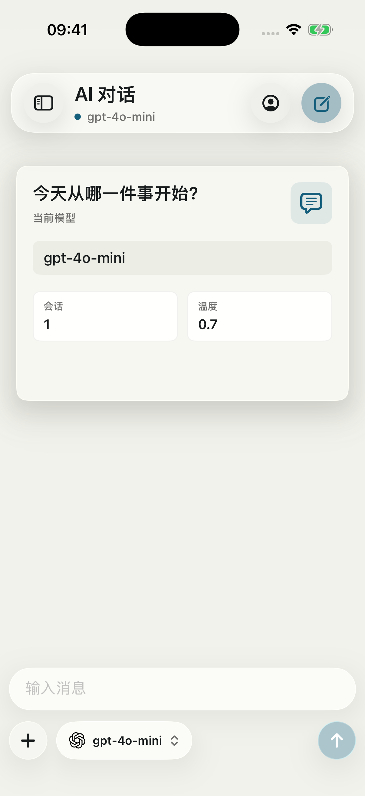

# Sonetto Chat

<p align="center">
  
</p>

<p align="center">
一个只做一件事的 iPhone AI 聊天客户端：接你自己的 OpenAI 兼容接口，数据只留在你自己的手机里。
</p>

---

## 它是什么

- **SwiftUI 单 Target iPhone App**，最低 iOS 17.0，零第三方依赖
- 只实现一种协议：OpenAI 兼容的 `{Base URL}/chat/completions`，所以 OpenAI、DeepSeek、Qwen、Kimi、Ollama、LM Studio、各种中转站都能直接接
- 多供应商、多助手（人格）、流式回复、块级 Markdown 渲染、图片/文件附件、分享长图
- API Key 存 Keychain，会话存本地 JSON，附件存沙盒 Documents；云备份只去**你自己的** WebDAV
- iOS 26 上使用原生 Liquid Glass（`glassEffect`），低版本自动回退到 `.ultraThinMaterial`

## 它不是什么

- **不是套壳浏览器**：全 SwiftUI，没有 WebView
- **不是云端产品**：没有账号、没有埋点、没有第三方 SDK；网络请求只发给你配置的接口和你配置的 WebDAV
- **不是功能全家桶**：没有语音、没有联网搜索、没有 function calling、不支持 Anthropic / Responses 原生协议
- **不是上架工程**：Bundle ID 还是占位值 `com.example.sonnetai`，也没做多语言和 App Store 适配

## 功能

### 聊天

- SSE 流式输出，随时停止；失败时展示服务端原始错误信息
- 消息操作：复制、编辑、重新生成、删除（二次确认）、分享
- 附件：相册图片、本地文件，随消息一起编码进请求
- 会话侧边栏：新建 / 切换 / 删除会话，按首条消息自动生成标题
- 导出：整段会话导出 Markdown；单条消息渲染成分享长图（复用同一套 Markdown 渲染管线，代码块、表格都能保留）
- Markdown 渲染：标题、列表、引用、表格、分割线、代码块，以及行内加粗 / 斜体 / 行内代码 / 链接

### 供应商

- 多个供应商档案：名称、Base URL、默认模型、温度
- 拉取 `{Base URL}/models` 获取可用模型，聊天页顶部可直接切换
- API Key 按供应商分别存 Keychain，不落 UserDefaults

### 助手（人格）

每个助手可以有独立的一套设定，切换助手就切换人格：

- 系统提示词 + 可点击插入的变量（当前时间、模型名等），支持消息模板
- 预设对话：每次会话开头注入 user / assistant 轮流消息
- 记忆条目：额外注入到系统提示词
- 快捷短语：聊天输入栏一键插入
- 正则规则：仅替换显示内容，或仅替换发送给模型的内容
- 头像支持 emoji 或相册图片，可替换气泡里的模型图标和名称
- 每个助手可单独覆盖：模型、温度、Top P、上下文消息条数、最大 token、流式开关

### 数据与备份

- WebDAV 云备份（坚果云、Nextcloud 等），可选备份会话和附件
- 本地导出 / 导入备份文件（JSON）
- 存储占用统计：附件、会话 JSON、临时文件分别统计
- 清理：临时文件、未被引用的附件、清空聊天记录

### 外观

- 浅色 / 深色 / 跟随系统
- 自定义玻璃质感界面：iOS 26 用原生 Liquid Glass，低版本用 `ultraThinMaterial`；开启「降低透明度」辅助功能时自动降级

## 界面

<p align="center">
  
</p>

<p align="center"><sub>iPhone 17 Pro / iOS 26.5 模拟器</sub></p>

## 技术栈

| 项目 | 说明 |
|---|---|
| 语言 | Swift 5（SwiftUI） |
| 最低系统 | iOS 17.0 |
| 设备 | iPhone（`TARGETED_DEVICE_FAMILY = 1`），仅竖屏 |
| 第三方依赖 | 无 |
| 网络 | `URLSession` + `AsyncThrowingStream`（SSE 解析） |
| 存储 | UserDefaults（会话 JSON）+ 沙盒文件（附件 / 头像）+ Keychain（密钥） |
| 构建验证 | Xcode 26.5 / iOS 26.5 SDK（工程格式兼容 Xcode 15+） |

## 目录结构

```text
AIChatApp/
├── AIChatAppApp.swift          # 入口
├── ContentView.swift           # 外观偏好入口
├── Models/                     # ChatMessage、Assistant
├── Services/
│   ├── OpenAIClient.swift      # /chat/completions 流式请求、/models
│   ├── SettingsStore.swift     # 供应商档案、模型列表、持久化
│   ├── AssistantStore.swift    # 助手生命周期与持久化
│   ├── KeychainStore.swift     # API Key / WebDAV 密码
│   ├── AttachmentStore.swift   # 附件落盘
│   ├── MarkdownParser.swift    # 块级 + 行内 Markdown 解析
│   ├── RenderCache.swift       # 渲染缓存
│   ├── BackupService.swift     # 备份归档与恢复
│   ├── WebDAVClient.swift      # WebDAV 上传 / 下载
│   ├── StorageUsageService.swift
│   └── AssistantImageStore.swift
├── ViewModels/
│   └── ChatViewModel.swift     # 会话状态、流式发送、导出
└── Views/
    ├── ChatView.swift          # 聊天主界面（侧边栏 / 输入栏 / 模型切换）
    ├── MessageBubble.swift
    ├── MarkdownView.swift
    ├── MessageShareCard.swift  # 分享长图
    ├── MessageEditSheet.swift
    ├── AttachmentPreview.swift
    ├── BackupView.swift
    ├── StorageView.swift
    ├── SettingsView.swift      # 设置 hub
    ├── LiquidGlassChrome.swift # Liquid Glass 封装与降级
    └── Assistant/              # 助手编辑页各 Tab
```

## 运行

1. 用 Xcode 打开 `Sonetto Chat.xcodeproj`
2. 在 target 的 Signing & Capabilities 里选择你自己的 Team（工程里的 `DEVELOPMENT_TEAM` 是原作者的）
3. 选一个 iPhone 模拟器或真机运行
4. 左上角设置 → 供应商设置，填 Base URL、API Key、模型，保存后开始聊天
5. 想在 iOS 26 上看到 Liquid Glass，用 iOS 26 模拟器运行

## 接口格式

App 会向以下地址发送请求：

```text
{Base URL}/chat/completions
```

请求体兼容 OpenAI Chat Completions：

```json
{
  "model": "gpt-4o-mini",
  "messages": [
    { "role": "system", "content": "You are a helpful assistant." },
    { "role": "user", "content": "Hello" }
  ],
  "temperature": 0.7,
  "stream": true
}
```

自定义供应商只要兼容 OpenAI SSE 流式返回即可直接使用；`/models` 不可用时也可以手动填写模型名。

## 数据与隐私

- API Key、WebDAV 密码存 iOS Keychain；会话、设置存 UserDefaults；附件存 App Documents
- 没有账号系统，不收集任何使用数据
- **注意**：导出的备份 JSON 里包含 API Key（用钥匙串恢复需要它），请把备份文件当密码一样保管
- 卸载 App 会一并删除本地数据，记得先导出备份

## 已知限制

- 只支持 OpenAI Chat Completions 协议，不支持 Anthropic 原生协议、Responses API、Gemini 原生协议（Gemini 可用其 OpenAI 兼容端点）
- 没有语音输入 / 语音朗读、联网搜索、function calling
- 只有 iPhone 竖屏布局，没有 iPad 与横屏适配
- 长会话一次性加载，消息特别多时没有做分页

## 致谢

- 交互与渲染管线借鉴了开源 AI 聊天客户端 rikkahub、kelivo 的设计
- `Assets.xcassets` 里的各模型品牌图标（OpenAI、Claude、Gemini、DeepSeek 等）版权归各自品牌所有，这里只用于界面上的模型识别

## 许可证

[MIT](LICENSE)
